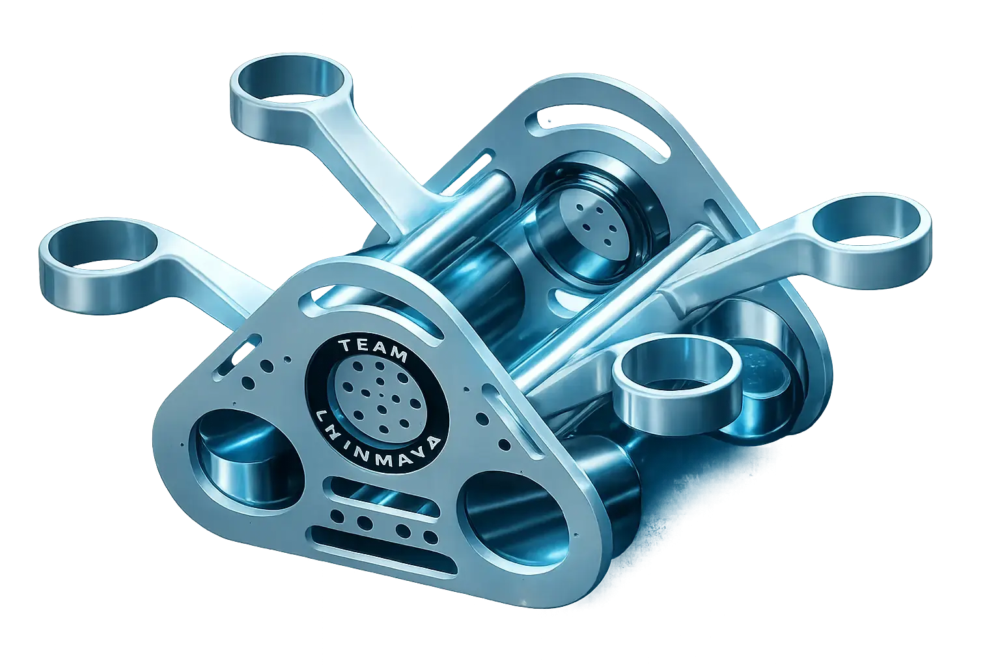
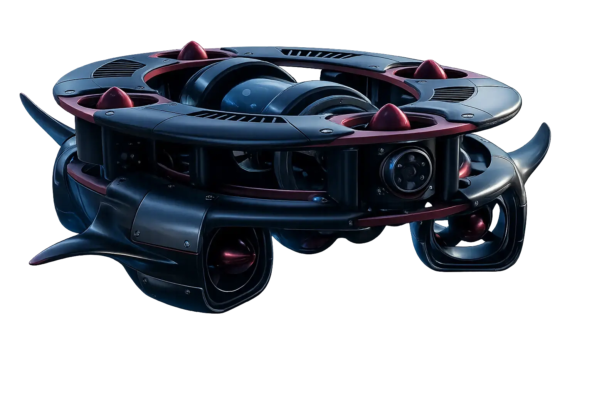

**Explore • Discover • Protect**

*A student team of the **Oceanic AI Centre**, Chinmaya Vishwa Vidyapeeth*

---

## 🔱 About Us

We are a student team building **Autonomous Underwater Vehicles (AUVs)** for research, inspection and exploration.
We design intelligent, autonomous systems that can work where people can't.

More than **80% of the deep ocean is still unexplored and unmapped**. It holds answers about our climate and its resources, and it holds infrastructure that needs inspecting and science still waiting to be done.
**We exist to unlock them.**

---

## 🚤 Our Vehicles

<table>
  <tr>
    <td align="center" width="50%">
      
      <h3>⭐ DHRUVA — Flagship</h3>
      
Built around a transparent core: a modular acrylic pressure hull protects the mission-critical electronics and allows modular integration and quick maintenance.

    </td>
    <td align="center" width="50%">
      
      <h3>PRAGNA</h3>
      
Engineered for stability and built for exploration. A rugged circular frame and advanced thruster systems give it precise control and reliability in demanding underwater environments.

    </td>
  </tr>
</table>

---

## 🧭 What Drives Us

| 🌐 Exploration | 💡 Innovation | 🛡️ Reliability |
| :---: | :---: | :---: |
| Pushing beyond known boundaries to discover what lies beneath. | Combining robotics, AI and engineering to solve real-world challenges. | Building robust systems that perform in the most demanding environments. |

---

## 🌊 Built for the Ocean

- **🏗️ Inspection Missions:** structural inspection of bridges, dams, pipelines and offshore assets
- **🔬 Research Applications:** oceanography, habitat mapping and environmental monitoring
- **🎓 Academic Development:** a modular platform for innovation, learning and experimentation
- **📡 Autonomous Navigation:** advanced sensors and control algorithms for autonomous operation

---

**Oceanic AI Centre · Chinmaya Vishwa Vidyapeeth**

*Exploring Earth's last frontier.* 🌊

